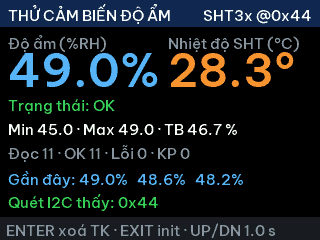

# Chương trình thử cảm biến độ ẩm (nhánh `test/hum-monitor`)

Firmware riêng để kiểm tra cảm biến **SHT3x / SHT4x** (I2C2: SCL = PB10, SDA = PB11) – đọc, hiển thị, ghi log
và theo dõi trực tiếp trong **Keil**. Bộ điều khiển máy sấy **không chạy**, mọi relay luôn **nhả**.



## Chuyển nhánh

```
git checkout test/hum-monitor      # chương trình thử độ ẩm
git checkout main                  # firmware máy sấy
```

Trong nhánh này `App/app.h` đặt `APP_HUM_MONITOR = 1`. Đặt `0` (hoặc về nhánh `main`) để chạy lại firmware máy sấy.
Keil: **Rebuild** → **Download (F8)**.

## Theo dõi bằng Keil (Watch – cập nhật trực tiếp)

1. **Debug → Start/Stop Debug Session** (Ctrl+F5), bấm **Run** (F5).
2. **View → Watch Windows → Watch 1** – biến `g_hum` đã được thêm sẵn (nếu chưa có: gõ `g_hum` vào ô *Enter expression*).
3. **View → Periodic Window Update** phải được tick → giá trị tự cập nhật khi CPU đang chạy (ST-Link đọc RAM qua SWD,
   không cần dừng chương trình).

| Trường trong `g_hum` | Ý nghĩa |
|----------------------|---------|
| `rh`, `temp` | độ ẩm %RH, nhiệt độ °C lần đọc gần nhất |
| `ok`, `status`, `status_text` | kết quả lần đọc: 0 OK · 1 BUS · 2 CRC · 3 NACK · 4 BUSY |
| `addr`, `family`, `serial` | địa chỉ I2C (0x44/0x45), 0 = SHT4x / 1 = SHT3x, số serial |
| `rh_min`, `rh_max`, `rh_avg` | min / max / trung bình trượt từ lần xoá thống kê |
| `n_read`, `n_ok`, `n_err[5]`, `n_recover` | số lần đọc, thành công, lỗi theo mã, số lần tự khôi phục bus I2C |
| `hist_rh[32]`, `hist_temp[32]`, `hist_pos` | 32 lần đọc gần nhất (vòng tròn, `hist_pos` = ô ghi tiếp theo) |
| `period_ms` | chu kỳ đọc |

Mẹo: chuột phải `g_hum.rh` → **Add to… → Logic Analyzer** để vẽ đồ thị độ ẩm theo thời gian
(cần ST-Link có chân SWO; ST-Link V2 clone thường không có → dùng Watch hoặc log UART).

## Màn hình TFT & nút

Độ ẩm / nhiệt độ số lớn, trạng thái (xanh OK / đỏ lỗi), Min · Max · TB, số lần Đọc · OK · Lỗi · KP (khôi phục), 6 lần đọc gần nhất.

| Nút | Tác dụng |
|-----|----------|
| ENTER | xoá thống kê (min/max/đếm/lịch sử) |
| EXIT | khởi tạo lại cảm biến (gỡ treo bus I2C + đọc lại serial) |
| UP / DOWN | chu kỳ đọc 0.5 · 1 · 2 · 5 · 10 s (mặc định 1 s) |

Lỗi 3 lần liên tiếp → firmware tự gỡ treo bus I2C và khởi tạo lại cảm biến (`n_recover` tăng).

## Log UART (PA9, 115200 8N1)

```
=== HUM MONITOR (nhanh test/hum-monitor) – relay luon nha ===
HUM init: SHT3x @0x44 serial 1234ABCD st=OK
HUM #12 RH=46.85% T=28.31C min=45.0 max=49.0 ok=12 loi=0
HUM #13 LOI NACK – không trả lời (lien tiep 1)
HUM khoi phuc bus I2C + init lai (lan 1)
```

## Kiểm tra trên PC

`sh tools/host_check/check.sh` – bước 6 chạy chương trình này với cảm biến giả (đọc đều, lỗi NACK → khôi phục,
nút bấm, không đóng relay) và lưu ảnh màn hình `tools/build/ui/hum_ok.ppm`, `hum_err.ppm`.

## Quét bus I2C (chẩn đoán đấu dây)

Lúc khởi động và mỗi lần bấm **EXIT**, chương trình quét bus I2C bằng GPIO (bit-bang) theo **cả 2 chiều dây**
rồi hiện kết quả ở dòng gần cuối màn hình (và log UART `HUM quet I2C: ...`, Keil Watch `g_hum.scan_*`):

| Màn hình | Nghĩa | Cách xử lý |
|---|---|---|
| `Quét I2C thấy: 0x44` | Cảm biến trả lời, đấu đúng | Nếu vẫn lỗi đọc → nhiễu/dây dài, thử dây ngắn hơn |
| `ĐẢO DÂY! Đổi SCL/SDA` | Chỉ trả lời khi đảo 2 dây | Đổi chỗ 2 dây: SCL → PB10, SDA → PB11 |
| `Quét I2C: không có thiết bị nào` | Không ai trả lời | Kiểm tra GND chung, VIN, chân ADDR, cảm biến hỏng |
| `SCL/SDA bị kéo thấp` | Chân bị giữ ở 0 V | Chập dây, module chưa cấp nguồn, thiếu trở kéo lên |

Module SHT31 ghi `SCL/T` và `SDA/RH`: bản I2C (SHT31-DIS) dùng như SCL/SDA bình thường.

## Đèn LED PC13

- **Sáng liên tục**: đang đọc được độ ẩm (lần đọc gần nhất OK).
- **Nháy 1 Hz**: chương trình đang chạy nhưng cảm biến lỗi / chưa đọc được.
