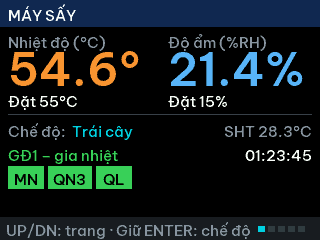
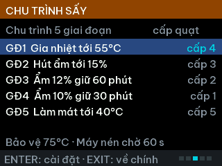
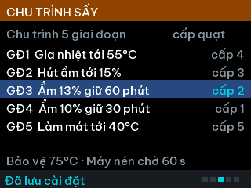
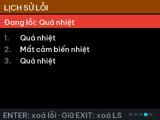
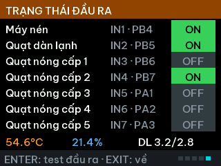
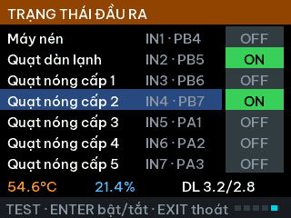
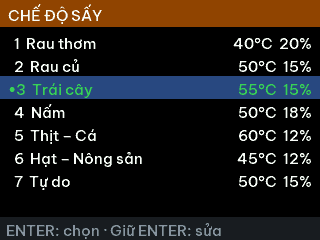
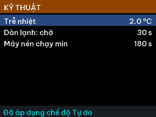

# Giao diện TFT & cách dùng nút

Ảnh dưới đây chụp từ bộ mô phỏng trên PC (`sh tools/host_check/check.sh`), chạy nguyên code `App/ui`.

## Font tiếng Việt

Giao diện dùng font **Be Vietnam Pro** (SIL Open Font License 1.1) chuyển thành bitmap anti-alias 2 bit/pixel:

| Font | Dùng cho | Ký tự | Flash |
|------|----------|-------|-------|
| `font_vn16` (15 px, cao dòng 23 px) | mọi chữ | ASCII + 134 chữ cái có dấu + `° · • – …` | ~9.5 KB |
| `font_num` (46 px, cao 35 px) | số lớn | `0-9 . - : % ° C` | ~3.8 KB |

* Chuỗi viết thẳng tiếng Việt trong code (file lưu **UTF-8**), ví dụ `"Nhiệt độ"`. Ký tự thiếu trong font hiện `?`.
* Đổi cỡ chữ / thêm ký tự: sửa bảng `FONTS` trong `tools/fontgen/fontgen.py` rồi chạy
  `python tools/fontgen/fontgen.py` (cần `pip install pillow`) → sinh lại `App/drivers/ili9341/fonts_vn.c`.
* Keil ARMCC 5: cần option `--no_multibyte_chars` (C/C++ → Misc Controls) – `tools/keil_setup.py` tự thêm.
* Toàn bộ firmware hiện ~52 KB / 62 KB Flash.

## 5 trang chính – chuyển bằng UP / DOWN

| Trang | Nội dung | Phím riêng |
|-------|----------|------------|
| 1 Chính | Nhiệt độ, độ ẩm (số lớn) + điểm đặt, chế độ sấy, giai đoạn đang chạy, đã sấy, relay (MN, QN + cấp, QL); GĐ3/GĐ4: *Còn hh:mm:ss* (đang giữ ẩm) hoặc *Chờ ẩm 12%* | Giữ EXIT 3 s: menu kỹ thuật |
| 2 Chạy / Dừng | Trạng thái, giai đoạn, đã sấy, giữ ẩm (GĐ3/GĐ4), máy nén | ENTER: chạy / dừng · Giữ EXIT 3 s: giả lập |
| 3 Chu trình sấy | Bảng 5 giai đoạn + cấp quạt dàn nóng, độ ẩm + thời gian giữ ẩm GĐ3/GĐ4, nhiệt độ bảo vệ, thời gian chờ máy nén | ENTER: danh sách cài đặt |
| 4 Lịch sử lỗi | Lỗi đang có + 6 lỗi gần nhất (1 = mới nhất; không có ngày giờ) | ENTER: xoá lỗi đang có · Giữ EXIT 3 s: xoá lịch sử |
| 5 Trạng thái đầu ra | 7 relay (máy nén, quạt dàn lạnh, quạt nóng cấp 1–5) kèm chân IN/GPIO, ô **ON** xanh / **OFF** xám. Dòng dưới: **nhiệt độ · độ ẩm · DL dàn lạnh 1/2 (°C)** hiện tại. Chân ra: ON = 0 V, OFF = 3.3 V (relay quạt kích mức thấp); riêng **máy nén PB4 đảo: ON = 3.3 V, OFF = 0 V**. Giả lập với *Relay thật = Tắt*: ô vàng **ON\*** = bộ điều khiển yêu cầu bật nhưng relay không đóng | **ENTER: test đầu ra** (xem dưới) |

Ở mọi trang: **giữ ENTER 3 s → menu chế độ sấy**, EXIT → về trang chính.
Header hiện tên trang (không còn đồng hồ); footer hiện gợi ý phím, thông báo và số trang (5 ô vuông).

 
 
 

### Test đầu ra (trang 5)

Bật/tắt tay từng relay để kiểm tra dây, đo điện áp chân ra. Chỉ vào được khi máy **không chạy** (Đang dừng hoặc đang Lỗi –
nên dùng được cả khi chưa gắn cảm biến).

| Phím | Tác dụng |
|------|----------|
| ENTER | vào test (dòng đang chọn tô xanh, footer hiện *TEST*) |
| UP / DOWN | chọn đầu ra |
| ENTER | bật / tắt đầu ra đang chọn |
| EXIT | thoát test, **tắt hết** |

* Quạt dàn nóng cộng dồn: ENTER ở dòng *Quạt nóng cấp N* → đóng relay cấp 1…N (thêm từng relay cách 1 s, ô **ON\*** vàng trong lúc chờ);
  ENTER lại ở dòng đang bật cao nhất → về cấp N−1.
* Máy nén vẫn giữ thời gian chờ bật lại (*Máy nén chờ … s*), kể cả ngay sau khi cấp điện.
* Luôn đóng relay thật (kể cả khi đang giả lập với *Relay thật = Tắt*).
* Đang test thì không chạy sấy được; 10 phút không bấm phím → tự thoát và tắt hết.



## Điều khiển quạt dàn nóng & máy nén

Chu trình **5 giai đoạn**, mỗi giai đoạn chọn cấp quạt dàn nóng riêng (đã bỏ chế độ Tự động và thời gian sấy):

| GĐ | Máy nén | Chuyển sang GĐ sau khi |
|----|---------|------------------------|
| 1 | quạt chạy trước 60 s, rồi máy nén chạy liên tục | nhiệt độ ≥ nhiệt độ đặt |
| 2 | giữ nhiệt độ đặt | độ ẩm ≤ độ ẩm đặt (của chế độ sấy) |
| 3 | giữ nhiệt độ đặt | độ ẩm ≤ *GĐ3: độ ẩm đạt* (mặc định 12 %) **liên tục** *GĐ3: giữ ẩm* phút (mặc định 60) |
| 4 | giữ nhiệt độ đặt | độ ẩm ≤ *GĐ4: độ ẩm đạt* (mặc định 10 %) **liên tục** *GĐ4: giữ ẩm* phút (mặc định 30) |
| 5 | **tắt** | nhiệt độ ≤ *GĐ5: nhiệt độ dừng* → kết thúc chu trình |

GĐ3 / GĐ4: đồng hồ giữ ẩm chỉ chạy khi độ ẩm đã ≤ mức đặt. Độ ẩm vượt lên quá mức đặt + 1 %RH → **đếm lại từ đầu**.
Chưa đạt ẩm: trang 1/2 hiện *Chờ ẩm 12%*; đang đếm: *Còn hh:mm:ss*. Mất cảm biến ẩm: chỉ tính thời gian (không bị kẹt).
Cài đặt ở trang 3 → ENTER: *GĐ3: độ ẩm đạt*, *GĐ3: giữ ẩm*, *GĐ4: độ ẩm đạt*, *GĐ4: giữ ẩm*.

Chung:
* **Máy nén chờ bật lại** (mặc định 60 s, chỉnh ở trang 3): sau mỗi lần dừng phải chờ đủ mới bật lại.
* **Nhiệt độ bảo vệ** (mặc định 75 °C, chỉnh ở trang 3): vượt → báo lỗi *Quá nhiệt*, **tắt máy nén**,
  **quạt dàn lạnh + quạt dàn nóng cấp 5 chạy liên tục** tới khi nhiệt độ ≤ *Quá nhiệt: nguội tới* (mặc định **30 °C**,
  chỉnh ở trang 3, luôn ≤ nhiệt độ bảo vệ − 5) → tự hết lỗi, máy dừng (cần bấm chạy lại). Chưa nguội thì ENTER ở trang 4
  không xoá được lỗi (báo *Chờ nguội về 30°C*), test đầu ra cũng bị khoá. Mất cảm biến nhiệt trong lúc làm mát → quạt vẫn chạy,
  xoá lỗi bằng tay. ⚠ Nếu trời nóng hơn 30 °C buồng sẽ không nguội tới 30 °C → quạt chạy mãi: tăng giá trị này (vd 35 °C).
* **Chống đóng băng dàn lạnh** (menu kỹ thuật, mặc định Bật): lấy nhiệt độ **thấp nhất** của 2 NTC dàn lạnh. Máy nén đang chạy
  mà dàn lạnh ≤ *Dàn lạnh: xả đá ≤* (mặc định **−2 °C**) liên tục *Dàn lạnh: chờ* (mặc định **60 s**) → **xả đá**: tắt máy nén,
  quạt vẫn chạy, giai đoạn vẫn tính giờ; dàn lạnh ≥ *Dàn lạnh: chạy lại ≥* (mặc định **5 °C**) → chạy tiếp (vẫn giữ thời gian chờ
  bật lại máy nén). Đang xả đá: dòng cảnh báo *Xả đá dàn lạnh x°C · chạy lại ≥5°C*. Không phải lỗi – không dừng máy.
  Mất 1 NTC: cảnh báo, dùng NTC còn lại; mất cả 2: không chống đóng băng được (chỉ cảnh báo).
* Quạt dàn lạnh chạy suốt chu trình. Quạt dàn nóng 5 cấp **cộng dồn**: cấp N = relay cấp 1…N cùng đóng
  (cấp 1 = 1 relay … cấp 5 = 5 relay); tăng cấp đóng thêm từng relay cách 1 s, giảm cấp nhả ngay.
* Mất cảm biến ẩm: bỏ qua GĐ2, GĐ3/GĐ4 chỉ tính thời gian (có cảnh báo).
* Đổi chế độ khi máy đang chạy: áp dụng từ lần chạy sau.

## Tự tắt màn hình

* **Tắt màn hình sau** (phút, mặc định **5**, chỉnh trong **menu kỹ thuật – giữ EXIT 3 s ở trang chính**, **0 = luôn sáng**): không bấm nút nào trong khoảng này
  → màn hình tô đen và tắt đèn nền. Máy vẫn chạy bình thường.
* Bấm **nút bất kỳ** → sáng lại đúng trang đang xem. Lần bấm đánh thức **không** thực hiện chức năng của nút
  (kể cả khi giữ lâu) – bấm lại lần nữa mới tác dụng.
* Có **lỗi mới** → màn hình tự sáng lại để người vận hành thấy.
* Đèn nền chỉ tắt hẳn khi chân **LED** của module TFT nối **PA11** (xem PINOUT.md); chưa nối thì màn hình chỉ đen.

## Menu chế độ sấy (giữ ENTER 3 s)

6 chế độ đặt sẵn + *Tự do*. Dấu `•` là chế độ đang dùng.

* UP / DOWN: chọn dòng · EXIT: thoát
* ENTER trên chế độ đặt sẵn: áp dụng ngay, lưu Flash
* **Giữ ENTER 3 s** trên chế độ đặt sẵn: sửa nhiệt độ / độ ẩm của chế độ đó
* ENTER trên *Tự do*: nhập nhiệt độ, độ ẩm rồi áp dụng



## Nhập số từng chữ số

Chữ số đang chỉnh có nền cam + gạch chân. UP / DOWN: tăng / giảm (0–9 vòng tròn, giữ để lặp).
ENTER: sang chữ số bên phải; ENTER ở chữ số cuối: **lưu**. EXIT: huỷ.
Nhiệt độ được giới hạn 30–75 °C, độ ẩm 5–80 %RH (ngoài khoảng sẽ bị kẹp và báo *Đã giới hạn*).


## Menu kỹ thuật (giữ EXIT 3 s ở trang chính)

Trễ nhiệt/ẩm, quá nhiệt, chống đóng băng dàn lạnh, thời gian bảo vệ máy nén, quạt, bù sai số cảm biến, *Tắt màn hình sau* (phút, 0 = luôn sáng).
ENTER: sửa · UP/DOWN: đổi theo bước · ENTER: xác nhận · EXIT: lưu & thoát.



## Đổi chế độ đặt sẵn

Tên và giá trị mặc định nằm trong `App/services/presets.c`. Giá trị người dùng sửa trên máy được lưu
trong Flash (settings), không mất khi mất điện.

## Chạy giả lập (khi chưa có cảm biến)

Vào: trang 2 **Chạy / Dừng** → **giữ EXIT 3 s** → danh sách *GIẢ LẬP (không lưu)*. Header chuyển **màu cam**,
trang chính hiện dòng `GIẢ LẬP · Mô hình x60`. Giả lập chỉ nằm trong RAM: tắt nguồn / reset là tắt.

Chưa gắn cảm biến nhiệt: lúc khởi động máy báo lỗi *Mất cảm biến nhiệt* và khoá chạy. **Bật giả lập sẽ tự xoá lỗi này**
(giá trị giả lập luôn hợp lệ) → ENTER ở trang 2 là chạy được. Chưa gắn NTC dàn lạnh: đặt *Chống đóng băng = Tắt*
trong menu kỹ thuật (trang 1, giữ EXIT 3 s) – cài đặt này lưu Flash.

| Mục | Giá trị | Ý nghĩa |
|-----|---------|---------|
| Giả lập | Tắt / **Mô hình** / **Chỉnh tay** | Mô hình: nhiệt độ, độ ẩm, dàn lạnh tự thay đổi theo máy nén + quạt. Chỉnh tay: bạn tự đặt nhiệt độ, độ ẩm |
| Tua nhanh | x1 / x10 / x60 / x300 | Đồng hồ bộ điều khiển chạy nhanh hơn (GĐ3 giữ ẩm 60 phút ở x300 còn 12 giây). Quạt 5 cấp vẫn nghỉ 1 s thật khi đổi cấp |
| Nhiệt độ, Độ ẩm | °C, %RH | Chỉnh tay: giá trị đưa vào bộ điều khiển. Mô hình: đặt lại điểm xuất phát |
| Tạo lỗi | Không / Mất CB nhiệt / Mất CB ẩm / Đóng băng | Thử các bảo vệ và lịch sử lỗi |
| Relay thật | Tắt / **Bật** | Mặc định chân ra + relay chạy theo bộ điều khiển khi giả lập → đo được điện áp thực tế. **Tháo dây máy nén / quạt (hoặc nguồn tải) nếu không muốn thiết bị chạy thật.** Tắt = chỉ hiện trên màn hình. |

Cách thử từng giai đoạn:
1. Trang 3: đặt cấp quạt, độ ẩm + thời gian giữ ẩm GĐ3/GĐ4.
2. Giả lập = **Mô hình**, Tua nhanh = **x60** → EXIT → ENTER để chạy. Theo dõi trang 1, 2, 3 (GĐ đang chạy được tô).
3. Muốn ép chuyển giai đoạn: Giả lập = **Chỉnh tay**, đặt nhiệt độ ≥ nhiệt độ đặt (qua GĐ1), độ ẩm ≤ độ ẩm đặt (qua GĐ2),
   nhiệt độ ≤ nhiệt độ dừng (kết thúc GĐ5).
4. Tạo lỗi *Đóng băng* (dàn lạnh xuống −8 °C → xả đá) hoặc đặt nhiệt độ > nhiệt độ bảo vệ → máy dừng, trang 4 ghi lỗi. Quá nhiệt: Chỉnh tay hạ nhiệt độ
   xuống ≤ 30 °C (hoặc để Mô hình tự nguội, môi trường 28 °C) → hết lỗi.

Trên PC, bước 5 của `sh tools/host_check/check.sh` chạy trọn 1 chu trình với cùng mô hình và in mốc từng giai đoạn:

```
TU DONG:   1 phút quạt chạy trước → 42 phút hút ẩm (T lên 61 °C) → giữ 55 °C tới 240 phút → làm mát → 256 phút xong
THU CONG:  GĐ1 31 phút → GĐ2 18 phút → GĐ3 120 phút → GĐ4 60 phút → GĐ5 11 phút → 240 phút xong
```
Mô hình chỉ gần đúng để kiểm tra trình tự, không thay được số đo thật.
